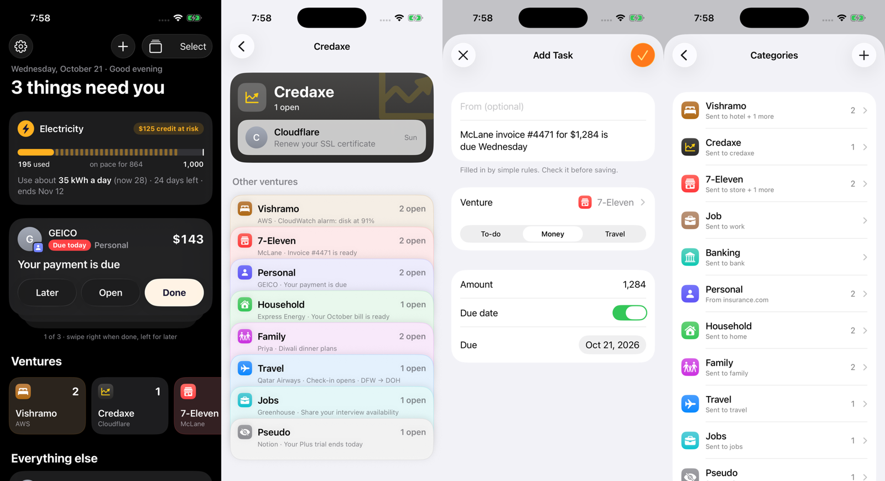

# Command Center

One iPhone app that tells me what needs me today: bills coming due, trials about to
charge, mail for each business I run, travel, the electricity budget, and my own
to-dos. It pulls all of that out of more than a dozen email inboxes so I don't
have to read them.



*Screenshots use made-up sample data.*

## How it works

```
 my email accounts ──forward──► one hub Gmail
                                    │
                    an email sorter (every 30 min, on GitHub Actions)
                    reads new mail, decides what each one is
                    (bill, trial, travel, task, just FYI) and which
                    category it belongs to, and pulls out amounts and due dates
                                    │
                                    ▼
                              a Notion database ◄── categories + their email rules
                                    │
                                    ▼
                   this app + its home-screen widget (iPhone)
```

- **The email sorter** lives in a separate, private repository because its settings
  hold my real email addresses. It also checks the electricity meter and sends a
  phone notification (through Bark) for anything urgent; tapping it opens this app.
- **Notion** is the shared list. The app and the sorter both read and write it, so
  every phone shows the same thing.
- **This app** is the only screen I look at.

## What the app does

- **Today:** a focus card for the most urgent item (swipe right when done, left for
  later), an electricity bar (how much I have used, where I'm heading, and the
  line I need to stay under), then everything grouped by category.
- **Categories:** each business or part of life (a store, a hotel, family, travel,
  car…) with its own icon and color. Each category has "send here" rules: email
  from a sender, to an address, or with words in the subject lands there. Edit
  them in the app; the sorter uses them on its next run.
- **Add a task by voice or screenshot:** the iPhone Action button dictates a task,
  and a back tap reads whatever is on screen. On-device Apple Intelligence (or
  simple rules) fills in the title, amount, due date and category. "Now"
  versions save without opening the app.
- **Edit anything:** tap a task to change its title, category, amount or due date.
  Moving an email's item to another category offers to "always send mail from
  this sender here".
- **Read the email** inside the app, and mark items done from the widget.

## Built with

SwiftUI for iOS 26 (Liquid Glass), WidgetKit, App Intents (Shortcuts, Action
button, Back Tap), Vision for reading screenshots, Foundation Models for
on-device task reading, and the Notion API. No server of my own.

## No Mac, no paid developer account

1. The Xcode project is generated from `project.yml` (XcodeGen).
2. Every push to `main` builds the app on a GitHub-hosted Mac
   (`.github/workflows/build.yml`), and another workflow takes the screenshots
   above in the simulator.
3. The build is published as a release, with a SideStore source file
   (`apps.json`), so SideStore on the iPhone installs it and keeps it updated.

## Privacy

This repository is public and holds no personal data or secrets. The Notion token
and the Gmail app password are typed into the app on each phone and kept in that
phone's Keychain. The sample data in `App/DemoData.swift` is made up.
